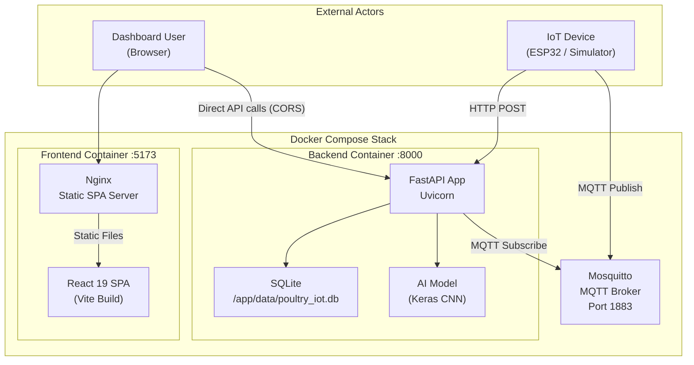
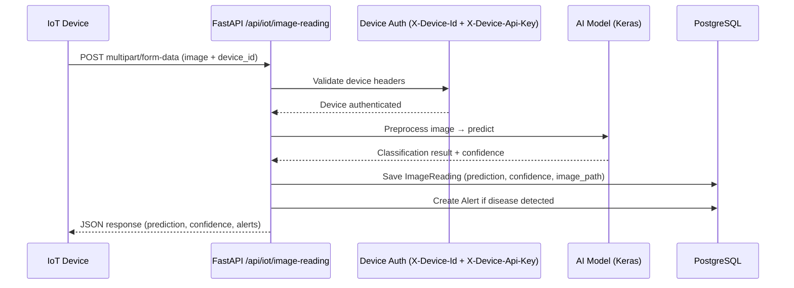
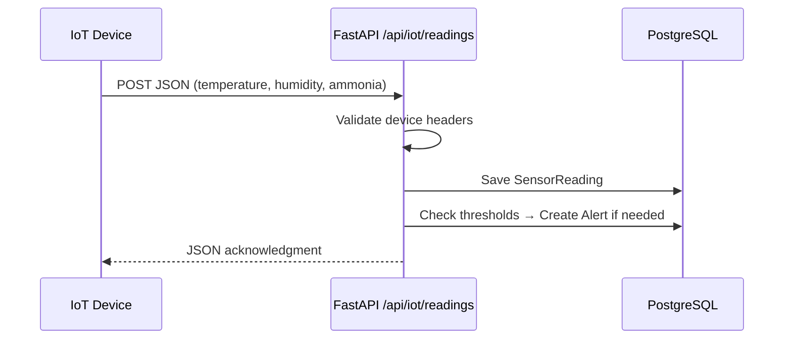
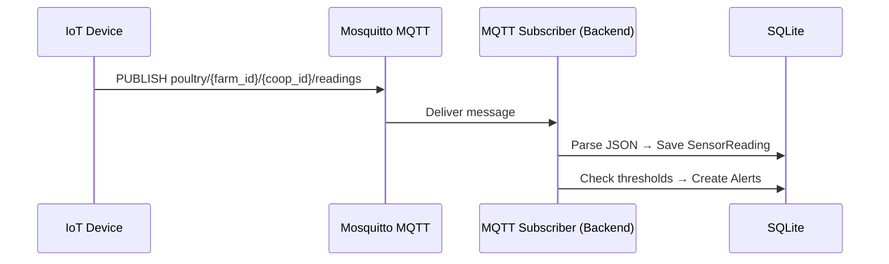
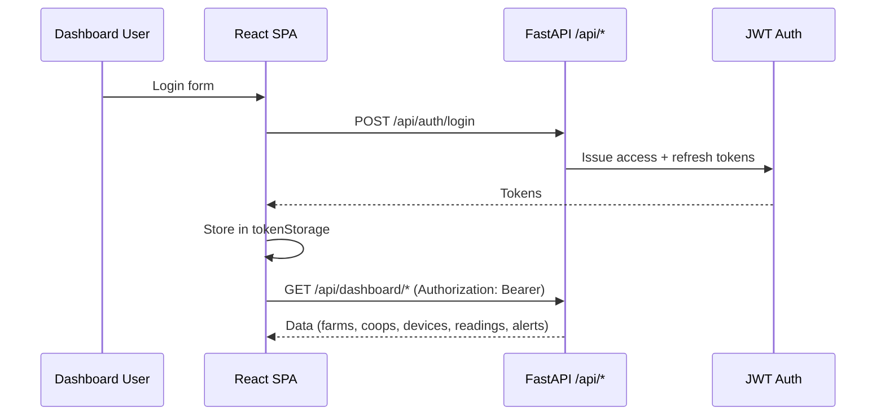
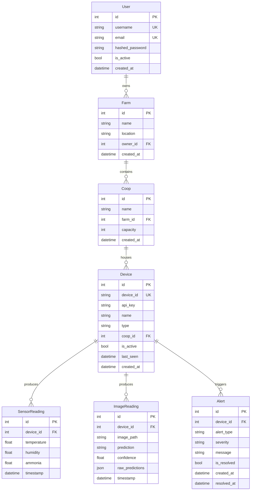
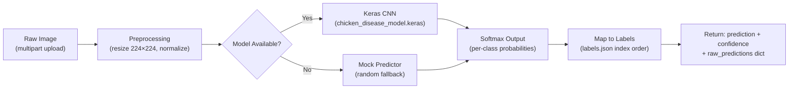
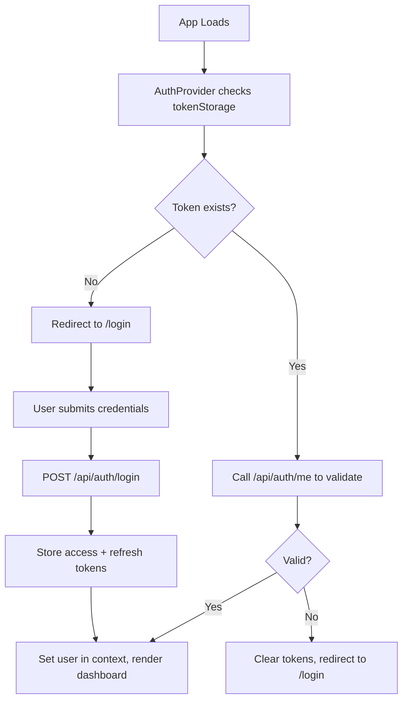
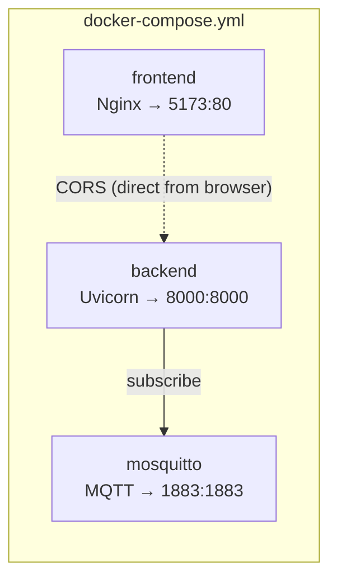

# IoT Poultry Health Monitoring Platform — Architecture Analysis

## System Overview

This platform monitors poultry health through **fecal image classification** (AI-powered droppings analysis) and **environmental sensor telemetry** (temperature, humidity, ammonia, weight). It consists of a **FastAPI backend**, a **React 19 (Vite) frontend dashboard**, a **Mosquitto MQTT broker** for device telemetry, a **SQLite database**, and a **Keras CNN AI model** for image classification.



> [!NOTE]
> The frontend does **not** proxy API requests through Nginx. The React SPA makes direct cross-origin HTTP requests to the backend on port 8000. CORS is configured on the FastAPI backend to allow this.

---

## High-Level Data Flows

### 1. Poultry Droppings Image Analysis Flow



### 2. Sensor Telemetry Flow (HTTP)



### 3. MQTT Telemetry Flow



### 4. Dashboard User Flow



---

## Backend Architecture

> **Stack**: Python 3.11+, FastAPI, SQLAlchemy, SQLite, Pydantic v2, MQTT (paho-mqtt), Keras/TensorFlow-CPU

### Directory Structure

```
backend/
├── app/
│   ├── main.py                 # FastAPI app factory, CORS, lifespan, MQTT startup
│   ├── config.py               # Pydantic Settings (env-based configuration)
│   ├── database.py             # Async SQLAlchemy engine, session factory
│   ├── models.py               # SQLAlchemy ORM models (10 tables)
│   ├── schemas.py              # Pydantic request/response schemas
│   ├── api/
│   │   ├── auth.py             # /api/auth/* (login, register, refresh, me)
│   │   ├── dashboard.py        # /api/dashboard/* (stats, charts, summaries)
│   │   ├── devices.py          # /api/devices/* (CRUD, assign to coops)
│   │   ├── farms.py            # /api/farms/* (CRUD, nested coops/devices)
│   │   ├── health.py           # /api/health (healthcheck)
│   │   ├── image_readings.py   # /api/image-readings/* (list, detail)
│   │   ├── iot.py              # /api/iot/* (device ingestion endpoints)
│   │   └── readings.py         # /api/readings/* (sensor data queries)
│   ├── services/
│   │   ├── alert_service.py    # Alert creation & threshold checking
│   │   ├── auth_service.py     # JWT token creation/validation, password hashing
│   │   ├── dashboard_service.py# Dashboard aggregation queries
│   │   ├── device_auth.py      # Device API key validation
│   │   ├── mqtt_service.py     # MQTT client, subscribe, message handling
│   │   └── reading_service.py  # Sensor reading persistence
│   └── ai_model/
│       ├── predictor.py        # KerasPredictor class + mock fallback
│       ├── preprocessing.py    # Image resize/normalization pipeline
│       └── model/
│           ├── labels.json           # Class label index order
│           ├── labels.example.json   # Example labels for reference
│           └── chicken_disease_model.keras/  # Real model (gitignored)
├── Dockerfile
└── requirements.txt
```

---

### Core Modules

#### [main.py](file:///home/aelfadl/Desktop/iot/backend/app/main.py) — Application Entry Point

- Creates the FastAPI application with **lifespan** context manager
- On startup: initializes database tables via `create_all()`, starts MQTT subscriber in background
- Configures CORS middleware (allows all origins in dev)
- Mounts all API routers under `/api/`

#### [config.py](file:///home/aelfadl/Desktop/iot/backend/app/config.py) — Configuration

Pydantic `BaseSettings` reading from environment variables (set via docker-compose.yml):

| Variable | Purpose | Default / Value |
|---|---|---|
| `DATABASE_URL` | SQLite connection string | `sqlite:///./data/poultry_iot.db` |
| `UPLOAD_DIR` | Image upload directory | `./uploads` |
| `JWT_SECRET_KEY` | JWT signing secret | `change-this-dev-secret` |
| `JWT_ALGORITHM` | JWT algorithm | `HS256` |
| `ACCESS_TOKEN_EXPIRE_MINUTES` | JWT expiry | `1440` (24 hours) |
| `MQTT_BROKER_HOST` | Mosquitto host | `mosquitto` |
| `MQTT_BROKER_PORT` | Mosquitto port | `1883` |
| `MODEL_PATH` | Keras model directory | `app/ai_model/model/chicken_disease_model.keras` |
| `LABELS_PATH` | Label index file | `app/ai_model/model/labels.json` |

#### [database.py](file:///home/aelfadl/Desktop/iot/backend/app/database.py) — Database Layer

- Creates SQLAlchemy engine connected to SQLite
- Provides session factory via `sessionmaker`
- Exports `get_db` dependency for FastAPI route injection
- Uses `create_all()` on startup for auto-schema creation (no migrations)

> [!WARNING]
> There are **no Alembic migrations**. Schema changes require `docker compose down -v` to destroy and recreate the database volume.

#### [models.py](file:///home/aelfadl/Desktop/iot/backend/app/models.py) — Database Models



> [!NOTE]
> The hierarchy is: **User → Farm → Coop → Device → Readings/Alerts**. This maps directly to the physical poultry farm structure.

---

### API Layer (Routes)

All routes live in [backend/app/api/](file:///home/aelfadl/Desktop/iot/backend/app/api/) and are thin wrappers that delegate to services.

#### Authentication — [auth.py](file:///home/aelfadl/Desktop/iot/backend/app/api/auth.py)

| Endpoint | Method | Auth | Purpose |
|---|---|---|---|
| `/api/auth/register` | POST | None | Create dashboard user |
| `/api/auth/login` | POST | None | Issue JWT access + refresh tokens |
| `/api/auth/refresh` | POST | Refresh Token | Rotate access token |
| `/api/auth/me` | GET | JWT Bearer | Get current user profile |

#### IoT Ingestion — [iot.py](file:///home/aelfadl/Desktop/iot/backend/app/api/iot.py)

> [!IMPORTANT]
> These endpoints use **device authentication** (`X-Device-Id` + `X-Device-Api-Key` headers), NOT JWT. This is intentionally separate.

| Endpoint | Method | Auth | Purpose |
|---|---|---|---|
| `/api/iot/readings` | POST | Device API Key | Submit sensor telemetry (temp, humidity, ammonia) |
| `/api/iot/image-reading` | POST | Device API Key | Upload droppings image for AI classification |

#### Dashboard Data — [dashboard.py](file:///home/aelfadl/Desktop/iot/backend/app/api/dashboard.py)

| Endpoint | Method | Auth | Purpose |
|---|---|---|---|
| `/api/dashboard/stats` | GET | JWT | Overview statistics (device count, alert count, etc.) |
| `/api/dashboard/recent-alerts` | GET | JWT | Latest alerts across all farms |
| `/api/dashboard/readings-chart` | GET | JWT | Time-series sensor data for charting |
| `/api/dashboard/health-summary` | GET | JWT | Per-coop health status overview |

#### Resource CRUD

| Router File | Prefix | Auth | Resources |
|---|---|---|---|
| [farms.py](file:///home/aelfadl/Desktop/iot/backend/app/api/farms.py) | `/api/farms` | JWT | Farms (create, list, detail, update, delete) |
| [devices.py](file:///home/aelfadl/Desktop/iot/backend/app/api/devices.py) | `/api/devices` | JWT | Devices (CRUD, assign to coop, regenerate API key) |
| [readings.py](file:///home/aelfadl/Desktop/iot/backend/app/api/readings.py) | `/api/readings` | JWT | Sensor readings (list, filter by device/date) |
| [image_readings.py](file:///home/aelfadl/Desktop/iot/backend/app/api/image_readings.py) | `/api/image-readings` | JWT | Image readings (list, detail with prediction) |
| [health.py](file:///home/aelfadl/Desktop/iot/backend/app/api/health.py) | `/api/health` | None | Health check |

---

### Services Layer

Services in [backend/app/services/](file:///home/aelfadl/Desktop/iot/backend/app/services/) contain all business logic:

| Service | Key Responsibilities |
|---|---|
| [auth_service.py](file:///home/aelfadl/Desktop/iot/backend/app/services/auth_service.py) | Password hashing (bcrypt), JWT creation/verification, user lookup |
| [device_auth.py](file:///home/aelfadl/Desktop/iot/backend/app/services/device_auth.py) | Validates `X-Device-Id` + `X-Device-Api-Key` headers against DB |
| [reading_service.py](file:///home/aelfadl/Desktop/iot/backend/app/services/reading_service.py) | Persists sensor readings, validates data ranges |
| [alert_service.py](file:///home/aelfadl/Desktop/iot/backend/app/services/alert_service.py) | Creates alerts based on thresholds (high temp, high ammonia, disease detection) |
| [dashboard_service.py](file:///home/aelfadl/Desktop/iot/backend/app/services/dashboard_service.py) | Aggregation queries for dashboard stats, charts, health summaries |
| [mqtt_service.py](file:///home/aelfadl/Desktop/iot/backend/app/services/mqtt_service.py) | MQTT client using paho-mqtt; subscribes to `poultry/+/+/readings`; parses messages and saves readings |

---

### AI Model Pipeline



- [predictor.py](file:///home/aelfadl/Desktop/iot/backend/app/ai_model/predictor.py): `KerasPredictor` class loads the real model; if model files are missing, falls back to `MockPredictor` that returns random predictions.
- [preprocessing.py](file:///home/aelfadl/Desktop/iot/backend/app/ai_model/preprocessing.py): Resizes images to 224×224, normalizes pixel values to 0–1 range.
- The label order in `labels.json` **must match training `class_names` exactly** — no sorting or renaming.

> [!WARNING]
> Real model files (`chicken_disease_model.keras/`) are **gitignored** and must be provided locally for real predictions. The mock fallback ensures the system doesn't crash without them.

---

## Frontend Architecture

> **Stack**: React 19, Vite 6, React Router DOM v7.15, Recharts 2.15, Tailwind CSS 3.4, Lucide React icons

### Directory Structure

```
frontend/
├── public/
├── src/
│   ├── main.jsx               # ReactDOM entry, wraps App in AuthProvider
│   ├── App.jsx                # Router configuration, protected routes
│   ├── App.css                # Global styles
│   ├── config/
│   │   └── api.js             # API_BASE_URL constant
│   ├── services/
│   │   ├── authService.js     # Login, register, refresh, logout
│   │   ├── tokenStorage.js    # localStorage get/set/clear for tokens
│   │   ├── apiClient.js       # Fetch wrapper with auth headers + auto-refresh
│   │   ├── farmService.js     # Farm CRUD API calls
│   │   ├── deviceService.js   # Device CRUD + API key management
│   │   ├── readingService.js  # Sensor reading queries
│   │   └── dashboardService.js# Dashboard stats, charts, alerts
│   ├── hooks/
│   │   └── useAuth.js         # Auth context consumer hook
│   ├── pages/
│   │   ├── LoginPage.jsx      # Login form
│   │   ├── RegisterPage.jsx   # Registration form
│   │   ├── DashboardPage.jsx  # Main dashboard with stats + charts
│   │   ├── FarmsPage.jsx      # Farm management list
│   │   ├── FarmDetailPage.jsx # Single farm with coops and devices
│   │   ├── DevicesPage.jsx    # Device management
│   │   ├── DeviceDetailPage.jsx# Device readings + alerts
│   │   ├── ReadingsPage.jsx   # Sensor data table/view
│   │   └── AlertsPage.jsx    # Alerts management
│   ├── components/
│   │   ├── Layout.jsx         # App shell (sidebar + header + content)
│   │   ├── Sidebar.jsx        # Navigation sidebar
│   │   ├── ProtectedRoute.jsx # Auth guard (redirects to login if no token)
│   │   ├── StatsCard.jsx      # Dashboard stat card component
│   │   ├── AlertList.jsx      # Alert display component
│   │   └── ...                # Additional UI components
│   └── utils/
│       └── formatters.js      # Date/number formatting helpers
├── index.html
├── package.json
└── vite.config.js
```

---

### Key Frontend Patterns

#### Authentication Flow



- **AuthProvider** (Context API) wraps the entire app
- **ProtectedRoute** component gates all dashboard routes
- **apiClient.js** automatically attaches `Authorization: Bearer` header and handles 401 → token refresh → retry
- **tokenStorage.js** uses `localStorage` for persistence

#### Routing Structure

| Path | Page | Auth Required |
|---|---|---|
| `/login` | LoginPage | No |
| `/register` | RegisterPage | No |
| `/` | DashboardPage | Yes |
| `/farms` | FarmsPage | Yes |
| `/farms/:id` | FarmDetailPage | Yes |
| `/devices` | DevicesPage | Yes |
| `/devices/:id` | DeviceDetailPage | Yes |
| `/readings` | ReadingsPage | Yes |
| `/alerts` | AlertsPage | Yes |

#### API Service Layer

All API calls go through service modules (never raw `fetch` in components):

```
Component → useEffect / event handler
    → service function (e.g., dashboardService.getStats())
        → apiClient.get/post/put/delete()
            → fetch() with auth headers
                → Backend API
```

---

## Infrastructure

### Docker Compose Services



| Service | Container Name | Image | Ports | Notes |
|---|---|---|---|---|
| `frontend` | `poultry-frontend` | Multi-stage: Node 20 build → Nginx Alpine | `5173:80` | Build arg: `VITE_API_BASE_URL` |
| `backend` | `poultry-backend` | `python:3.11-slim` + Uvicorn | `8000:8000` | SQLite in volume, auto `create_all()` |
| `mosquitto` | `poultry-mosquitto` | `eclipse-mosquitto:2` | `1883:1883` | Anonymous access, no persistence |

**Volumes:**
- `backend_data` → `/app/data` (SQLite database)
- `backend_uploads` → `/app/uploads` (uploaded droppings images)

**Bind Mounts (backend):**
- `./scripts` → `/app/scripts` (read-only)
- `./reports` → `/app/reports`
- `./simulator/sample_images` → `/app/simulator/sample_images` (read-only)
- `./backend/app/ai_model/model` → `/app/app/ai_model/model` (read-only)

### Nginx Configuration — [nginx.conf](file:///home/aelfadl/Desktop/iot/frontend/nginx.conf)

Nginx serves as a **static SPA server only** (no API proxy):
1. Listens on port 80 (mapped to host 5173)
2. Serves the Vite-built React SPA from `/usr/share/nginx/html`
3. SPA fallback: `try_files $uri $uri/ /index.html` for client-side routing

> [!IMPORTANT]
> There is **no reverse proxy** for `/api/*`. The frontend makes direct HTTP requests to `http://localhost:8000` from the browser. This requires CORS to be properly configured on the backend.

### Mosquitto (MQTT Broker)

- Config at [mosquitto/config/mosquitto.conf](file:///home/aelfadl/Desktop/iot/mosquitto/config/mosquitto.conf)
- Listens on port 1883 (unencrypted)
- **Anonymous access** — no broker authentication
- **No persistence** — messages not stored on disk
- Topic pattern: `poultry/{farm_id}/{coop_id}/readings`
- Backend subscribes using wildcard: `poultry/+/+/readings`

---

## Supporting Tools

### Simulator — [edge_simulator.py](file:///home/aelfadl/Desktop/iot/simulator/edge_simulator.py)

A Python script (~347 lines) that simulates an ESP32/ESP32-CAM IoT device:

| Mode | Transport | Target |
|---|---|---|
| `sensor-http` | HTTP POST JSON | `http://localhost:8000/api/iot/readings` |
| `sensor-mqtt` | MQTT publish | `poultry/farm-01/coop-01/readings` |
| `image-http` | HTTP multipart | `http://localhost:8000/api/iot/image-reading` |
| `heartbeat` | HTTP POST JSON | `http://localhost:8000/api/iot/heartbeat` |

- **Device identity**: `esp32-sim-01` with API key `dev-secret-key`
- **Sensor data**: temperature (28–36°C), humidity (55–85%), weight (0.8–2.6 kg), battery, wifi_rssi
- **Payload**: Versioned (`schema_version: 1.0`) with `device`, `location`, `timestamp`, `data`, `metadata` fields
- **Image mode**: Randomly picks from 6 sample droppings images in `simulator/sample_images/`
- **Loop interval**: 5 seconds (or `--once` for single shot)

### Scripts — [scripts/](file:///home/aelfadl/Desktop/iot/scripts/)

Contains [validate_model_predictions.py](file:///home/aelfadl/Desktop/iot/scripts/validate_model_predictions.py) (~350 lines):
- Imports the production predictor from `backend.app.ai_model.predictor`
- Scans sample images, detects expected labels from filenames (alias mapping)
- Runs predictions, compares expected vs actual
- Prints summary table + accuracy stats
- Writes CSV report to `reports/model_validation_report.csv`
- Latest result: **6 images tested, 2 correct (~33% accuracy)** — model needs improvement

### Makefile

| Target | Command |
|---|---|
| `make up` | `docker compose up -d --build` |
| `make down` | `docker compose down` |
| `make validate-model` | Runs validation script inside backend container |

---

## Authentication Model Summary

> [!IMPORTANT]
> Authentication is **intentionally split** by actor type. These must never be merged.

| Actor | Auth Mechanism | Used For | Token Location |
|---|---|---|---|
| **Dashboard User** | JWT Bearer Token | All `/api/auth/*`, `/api/dashboard/*`, `/api/farms/*`, `/api/devices/*`, `/api/readings/*` | `Authorization: Bearer <token>` header |
| **IoT Device** | API Key | `/api/iot/readings`, `/api/iot/image-reading` | `X-Device-Id` + `X-Device-Api-Key` headers |
| **MQTT Device** | None (broker-level) | MQTT publish to `poultry/+/telemetry` | N/A (development) |

---

## Key Design Decisions

| Decision | Rationale |
|---|---|
| **Async SQLAlchemy** | Non-blocking DB calls for high-throughput IoT ingestion |
| **Dual ingestion (HTTP + MQTT)** | HTTP for request-response (images), MQTT for fire-and-forget telemetry |
| **Mock AI fallback** | Enables local development without 200MB+ model files |
| **Separate auth paths** | Devices don't have user accounts; dashboard users shouldn't need API keys |
| **Thin API routes** | Business logic in services for testability and reuse |
| **React SPA + Nginx reverse proxy** | Single deployment unit; Nginx handles routing + static files efficiently |
| **Labels.json index order** | Must match training class_names to avoid prediction mismatches |

---

## Technology Summary

| Layer | Technology |
|---|---|
| **Backend Framework** | FastAPI (Python 3.11+) |
| **Database** | SQLite (via SQLAlchemy) |
| **ORM** | SQLAlchemy 2.x |
| **Validation** | Pydantic v2 |
| **Auth** | JWT (python-jose) + bcrypt/passlib |
| **AI/ML** | TensorFlow-CPU / Keras (CNN image classifier) |
| **Image Processing** | Pillow |
| **Message Broker** | Eclipse Mosquitto 2 (MQTT) |
| **MQTT Client** | paho-mqtt (Python) |
| **Frontend Framework** | React 19 |
| **Build Tool** | Vite 6 |
| **CSS Framework** | Tailwind CSS 3.4 |
| **Charting** | Recharts 2.15 |
| **Icons** | Lucide React |
| **Routing** | React Router DOM v7.15 |
| **State Management** | React Context API |
| **Web Server** | Nginx Alpine (static SPA only) |
| **Containerization** | Docker + Docker Compose |

---

## Gaps & Observations

> [!WARNING]
> These are areas that may need attention for production readiness.

| # | Gap | Impact | Recommendation |
|---|---|---|---|
| 1 | **SQLite database** | Not suitable for concurrent writes at scale | Migrate to PostgreSQL for production |
| 2 | **No database migrations** | Schema changes require destroying data (`down -v`) | Add Alembic for migration management |
| 3 | **No CI/CD pipeline** | No automated testing or deployment | Add GitHub Actions workflow |
| 4 | **Dev JWT secret hardcoded** | `change-this-dev-secret` in docker-compose | Use proper secret management |
| 5 | **Anonymous MQTT** | Any client can publish to the broker | Add MQTT authentication |
| 6 | **No TLS/HTTPS** | All traffic is unencrypted | Add TLS termination (nginx or reverse proxy) |
| 7 | **No nginx API proxy** | Frontend makes direct CORS calls to :8000 | Consider proxying API through nginx |
| 8 | **Low model accuracy** | ~33% on sample images | Retrain model or improve training data |
| 9 | **No automated tests** | No unit or integration test suite | Add pytest for backend, Vitest for frontend |
